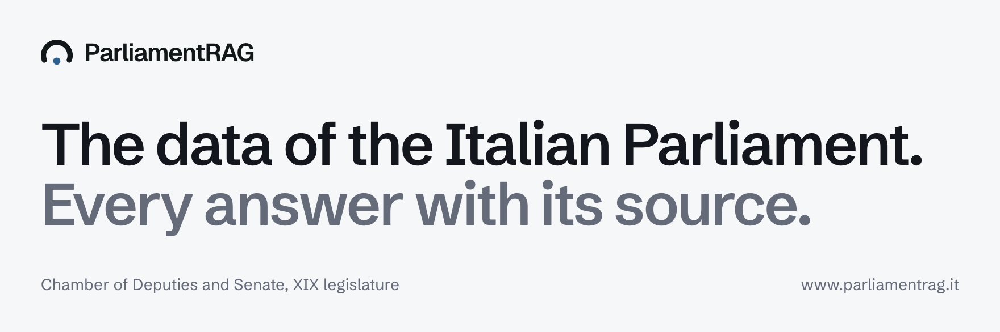
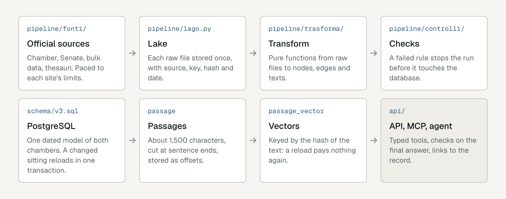

<picture>
  <source media="(prefers-color-scheme: dark)" srcset="docs/assets/testata-scuro.png">
  
</picture>

<p>
  <a href="LICENSE"></a>
  <a href="https://doi.org/10.5281/zenodo.23173703"></a>
  
  
  <a href="https://www.parliamentrag.it"></a>
</p>

ParliamentRAG organises the records of the Italian Parliament, Chamber of Deputies and Senate, into one database, and answers questions about them under three guarantees that anyone can check:

1. **Every parliamentary group is heard.** An answer about a debate covers majority and opposition, and the components of the Mixed Group one by one.
2. **The voices quoted are authoritative on the topic.** For each group the system quotes the members who know the subject, by criteria that you can inspect.
3. **Every quote is exact.** Text between «…» matches the official record word for word and links to it.

<picture>
  <source media="(prefers-color-scheme: dark)" srcset="docs/assets/sigillo-scuro.png">
  
</picture>

This repository holds the whole system: the nightly pipeline from the official sources, the PostgreSQL schema, the semantic index, the public API, the MCP server for AI assistants, and the checks behind the three guarantees. The live service runs at [www.parliamentrag.it](https://www.parliamentrag.it).

> **In italiano.** ParliamentRAG raccoglie in un solo database gli atti della Camera e del Senato (XIX legislatura) e risponde alle domande con tre garanzie verificabili: tutti i gruppi, voci autorevoli sul tema, citazioni esatte con il link al resoconto ufficiale. Qui c'è tutto il sistema: lo scarico notturno dalle fonti ufficiali, lo schema del database, la ricerca per significato, l'API, il server MCP e i controlli delle garanzie. Codice e commenti sono in italiano; la guida per chi sviluppa è in [docs/sviluppo.md](docs/sviluppo.md).

## Contents

- [Research questions](#research-questions)
- [Corpus](#corpus)
- [Data model](#data-model)
- [Pipeline](#pipeline)
- [Semantic retrieval](#semantic-retrieval)
- [The three guarantees](#the-three-guarantees)
- [Interfaces](#interfaces)
- [Evaluation](#evaluation)
- [Reproducing the database](#reproducing-the-database)
- [Repository layout](#repository-layout)
- [Status and roadmap](#status-and-roadmap)
- [Limitations](#limitations)
- [Citing](#citing)
- [People and support](#people-and-support)
- [Licence](#licence)

## Research questions

Official parliamentary data in Italy is public, but scattered over a dozen services with different formats, identifiers and update rhythms. A language model asked about Parliament will answer fluently and leave out groups, quote whoever matches the words of the question, and paraphrase speeches inside quotation marks. The project works on three questions:

- **RQ1. Integration.** How do you build a single, dated, provenance-preserving model of both chambers, where a person, a group or a bill keeps one identity across sources and legislative terms?
- **RQ2. Authority.** How do you rank who speaks with competence on a topic, from public evidence only (speeches, sponsored acts, committee seats, offices, declared profession and education), in a way that a reader can audit?
- **RQ3. Verifiability.** Which properties of a generated answer can a deterministic procedure check against the records, and how should the system behave when a check fails?

The system answers RQ3 with a conservative rule: when it cannot quote a balanced, authoritative and exact set of voices, it reports data and acts without quotes, or says that the evidence is lacking.

## Corpus

XIX legislature (from 13 October 2022), both chambers. Counts from the database on 3 November 2026:

| Record | Count |
|---|---:|
| Sittings (floor, committees, scheduled) | 24,822 |
| Speeches | 469,181 |
| Roll-call votes | 28,670 |
| Individual votes | 9,658,504 |
| Acts (bills, questions, motions, resolutions, agenda orders) | 50,307 |
| Amendments | 229,617 |
| Documents (research dossiers, written evidence, committee annexes) | 19,322 |
| People | 938 |

Sources, all official:

| Source | What it gives | Licence |
|---|---|---|
| [dati.camera.it](https://dati.camera.it) (SPARQL) | members, groups, bodies, offices, governments, bills, oversight acts, votes | CC BY-SA 3.0 IT |
| www.camera.it, documenti.camera.it | stenographic records of the floor and of committees, the committee bulletin, agenda, amendments, bill texts, written evidence, WebTV timings | terms of the site |
| [temi.camera.it](https://temi.camera.it) | research dossiers of the Chamber's documentation services | CC BY-SA 4.0 |
| [dati.senato.it](https://dati.senato.it) | senators, groups, committees, bills and signatories, votes | terms of the site |
| [Akoma Ntoso bulk data of the Senate](https://github.com/SenatoDellaRepubblica/AkomaNtosoBulkData) | floor records, committee summaries, bill texts, amendments | CC BY 4.0 |
| EuroVoc, TESEO | subject thesauri for acts and topics | EU and Senate terms |

## Data model

The model is a property graph stored in PostgreSQL 16: nodes and edges become tables with typed columns (`schema/v3.sql`). An RDF view through R2RML mappings is planned. Four choices shape the model.

**One identity per entity.** A person has one row across legislatures and chambers. A senator who sat in the Chamber, or a minister who is not a member, links to every record with `person_same_as`. Speeches, votes and signatures count under the person, whatever the source called them.

**Everything is dated.** Group membership, committee seats, offices and government posts carry start and end dates. `group_at(person, date)` returns the group a person belonged to on the day of a speech or a vote. The query prefers the component of the Mixed Group over the Mixed Group as a whole, because each component is a political subject of its own.

**Text keeps its status.** A segment of a record is `verbatim` (what was said) or `summary` (the official summary written by the clerks, as in the Chamber's committee bulletin and the Senate's committee reports). A third-party document (written evidence, an annex) carries `third_party`. The status decides what you may quote, and how the interface presents it.

**Provenance down to the character.** Every row keeps its source, source key and content hash. Speech segments, reactions from the floor ("Applausi dei deputati del gruppo…") and search passages keep start and end offsets into the canonical text. You can rebuild any quote from the official text.

Core tables:

| Area | Tables |
|---|---|
| Sittings and records | `sitting`, `agenda_item`, `agenda_item_act`, `speech`, `segment`, `reaction`, `reaction_from`, `speech_mention` |
| People and institutions | `person`, `person_same_as`, `grp`, `grp_alias`, `body`, `mandate`, `membership`, `seat`, `office`, `government`, `ministry` |
| Legislation and oversight | `act`, `act_step`, `act_version`, `act_sponsor`, `act_assignment`, `act_rapporteur`, `act_joint`, `act_transmission`, `act_text`, `act_article`, `act_citation`, `act_subject`, `act_addressee`, `amendment`, `amendment_signer` |
| Votes | `vote`, `vote_act`, `ballot` |
| Documents and video | `document`, `video`, `video_segment` |
| Subjects | `entity`, `concept`, `concept_match` |
| Semantic index | `passage`, `passage_vector`, `vector_batch` |

## Pipeline

A nightly run downloads what changed, transforms it and loads it (`pipeline/`). It uses the Python standard library plus `pypdf` for PDF text.

<picture>
  <source media="(prefers-color-scheme: dark)" srcset="docs/assets/pipeline-scuro.png">
  
</picture>

- **Lake.** Each raw file is stored once, with source, key, hash, URL and date. Transforms start from the lake, so you can rebuild any table without downloading again.
- **Transforms** are pure functions from a raw file to nodes, edges and texts. Each one has a test on a real sample in `tests/fixtures/`.
- **Checks** run before loading, with rules for each source: structure of sittings, people, acts and videos; for votes, the published totals against the individual ballots. A failed rule stops the run before it touches the database. Totals that differ inside the source itself (a few sittings in April 2024) raise a warning.
- **Loading** replaces a changed sitting inside one transaction, so the database holds either the old version or the new one, complete.
- **Orchestration** (`orchestra.py`): steps with dependencies, timeouts, retries and resume; one run at a time; state in SQLite. A failed step stops only the steps that depend on it.

The connectors respect the limits of each site: pauses between requests, a cap per night for the large archives, partial git clones for the Senate bulk data. The Senate website and the Chamber both block an address that sends too many requests in a row.

## Semantic retrieval

Search by meaning runs on `text-embedding-3-large` at 1,024 dimensions. The pipeline sends every text through the OpenAI Batch API, which costs half the interactive price; only the question is embedded at query time.

**Passages.** The pipeline cuts each text into passages of about 1,500 characters, at sentence ends. The sentence splitter knows Italian parliamentary abbreviations (`n.`, `on.`, `art.`, `A.C.`, initials, list numbers). A remainder shorter than 300 characters joins the passage before it. The table stores each passage as a pair of offsets into the source text.

**Sources.** Speeches, the texts of oversight acts, bill titles, bill texts, research dossiers, written evidence and annexes, amendments, the declared profession and education of members, and the names of bodies. The authority score needs the first six; the agent's search uses all of them.

**Content addressing.** A vector belongs to the SHA-256 of the passage text and to the model (`passage_vector`). When a sitting is reloaded, unchanged passages find their vectors again and cost nothing. A new model can sit next to the old one. Vectors use half precision (`halfvec`), which halves storage and lets the HNSW index fit in memory.

**Choice of model.** Two studies on the database. In the first, 3,870 texts and 302 questions with known answers in three families (bill topics, oversight questions, citizen paraphrases) compared full-text search, three open models run locally and two OpenAI models. `text-embedding-3-large` led on paraphrases, the questions closest to what people type (0.84 with a right answer among the first 10, against 0.53 for full-text search). The second study fixed the dimensions on 20,000 passages and 180 questions: the right passage was among the first 10 in 87% of cases at 1,024 dimensions, the same as at 3,072, in a third of the space.

## The three guarantees

The checks are deterministic and run on the final answer, with the question.

| Guarantee | Check |
|---|---|
| All groups | The groups and Mixed Group components with a voice on the topic in the period appear in the answer. The answer says so when a group has no speech on the topic. |
| Authoritative voices | Each quoted member ranks high for the question on an authority score with six components: speeches on the topic, sponsored acts on the topic (first signatory weighs more than co-signatory, recent acts weigh more), seats on the competent committees, offices, profession, education. Each component is relative to the other speakers for the same question. |
| Exact quotes | Every «…» is found, word for word after normalising quotes and spaces, in a verbatim speech. A committee summary is accepted only when the answer says it is a summary. The agent may only output links it received from its tools. |

When a check fails, you see the failure next to the answer. The system keeps the answer as it was.

## Interfaces

**REST API** (`api/main.py`, FastAPI): people, composition of a chamber, sittings, votes with individual ballots, acts and amendments, search in speeches, under `/v1`. It reads PostgreSQL with a read-only role, an 8-second statement timeout and a rate limit per address. No route accepts free queries. Documentation at `/v1/docs`.

**MCP server** (`POST /mcp`): eight tools for AI assistants (claude.ai, ChatGPT, Claude Desktop): `search_parliament`, `get_debate`, `list_sessions`, `get_session_votes`, `get_vote_details`, `get_voted_text`, `get_vote_hemicycle`, `verify_answer`. Every result links to the official record.

**Agent** (`POST /v1/chat`): a language model that chooses among the typed tools of `api/strumenti/` and answers in Italian or English, with limits on steps, questions per address and daily spend outside the model.

## Evaluation

**Benchmark.** `benchmark/` holds 658 questions that 15 user profiles (journalists, researchers, citizens, staff, students and others) ask about Parliament, by category and chamber, plus trap questions (out of domain, requests for opinions, false premises). Six agents wrote them on 2 November 2026, each playing a profile and reading the database, so acts, people and numbers are real. 507 have an answer you can compute from the data; 100 have a reference answer computed in SQL. Domain experts have not validated them yet. The schema is in `benchmark/SCHEMA.md`.

**Pilot, 2 November 2026,** 30 questions and 5 traps, scored 0 to 2 on correctness: mean **0.50**. The system rarely invented facts: when data was missing it said so, and it passed 4 traps out of 5. It answered fewer than half of the questions in full. All 51 quotes in the topic dossiers were exact. Counting questions and filters by chamber and period caused most errors; the work in progress addresses both. Full report in `benchmark/pilota-2026-11-02/RAPPORTO.md`.

**Retrieval study.** `benchmark/embedding/`: passages, questions, scripts and results of the comparison of embedding models and dimensions.

## Reproducing the database

You need Docker, Python 3.13 and about 25 GB of disk: 7 GB for the lake, 6 GB for the database before vectors, a few more for vectors and index.

```sh
cp .env.example .env                  # set PG_PASSWORD; OPENAI_API_KEY only for the vectors
docker compose up -d                  # PostgreSQL 16 with pgvector, port 5440
python3 -m venv .venv && .venv/bin/pip install -r requirements.txt
.venv/bin/python -m pipeline giro     # one full run; the first one takes several nights
.venv/bin/python -m pipeline stato    # outcome of every step
.venv/bin/python -m unittest discover -s tests -t .
```

Vectors, after loading:

```sh
.venv/bin/python -m pipeline.vettori taglia     # passages of new or changed texts
.venv/bin/python -m pipeline.vettori invia 20   # 20 batches of 2,000 passages
.venv/bin/python -m pipeline.vettori raccogli   # collect finished batches
.venv/bin/python -m pipeline.vettori indice     # HNSW index, once all vectors are in
```

The API: `.venv/bin/pip install -r requirements-api.txt`, then `.venv/bin/uvicorn api.main:app --port 8790`. Every dependency has a pinned version.

## Repository layout

```
pipeline/     nightly run: fonti/ (connectors), trasforma/, controlli/, carica/, vettori.py, orchestra.py
schema/       v3.sql (tables, functions, indexes), lettura.sql (read-only role)
api/          FastAPI app: strumenti/ (typed tools), agente.py, mcp.py, pubblico.py (public MCP tools)
benchmark/    questions, reference answers, pilot results, embedding study
tests/        unit tests with real samples in fixtures/
docs/         developer guide (Italian)
```

## Status and roadmap

November 2026. The database holds both chambers of the XIX legislature; the nightly run fills the last archives of the Chamber (dossiers, written evidence, bill texts). Next steps, in order:

1. Vectors for all sources, then the HNSW index.
2. One service: site, agent, dossier, checks, API and MCP on PostgreSQL, on Railway, at www.parliamentrag.it.
3. The authority score and the group check on PostgreSQL, with filters by chamber and period; a run on the full benchmark.
4. Counting tools for numeric questions; the nightly run on a server; a public dump of the database with a DOI.

## Limitations

- XIX legislature only. Earlier terms use other formats and are not loaded.
- The newest Senate records reach the bulk data a few days late.
- Written evidence and annexes belong to third parties: the interface shows extracts with a link to the full text.
- Profession and education come from what members declare to their chamber. The Senate publishes no education, so that component is missing for senators.
- Authority measures activity and declared competence in public records. It does not judge the quality of what a member says.
- Committee summaries paraphrase what was said: the system can quote them only as summaries.

## Citing

The first version of the system, built on a Neo4j knowledge graph, appears in:

```bibtex
@inproceedings{tritella2026whospeaksmatters,
  author    = {Tritella, Mirko and Pozzi, Riccardo and Palmonari, Matteo},
  title     = {Who Speaks Matters: Authority-Aware Multi-View Retrieval-Augmented Generation over Italian Parliamentary Proceedings},
  booktitle = {Proceedings of the 25th International Semantic Web Conference (ISWC 2026), In-Use Track},
  publisher = {Springer},
  year      = {2026}
}
```

Code of that version: [10.5281/zenodo.23173703](https://doi.org/10.5281/zenodo.23173703). RDF dataset: [10.5281/zenodo.21560331](https://doi.org/10.5281/zenodo.21560331).

## People and support

Mirko Tritella, with Riccardo Pozzi and Matteo Palmonari, Department of Informatics, Systems and Communication (DISCo), University of Milano-Bicocca.

Supported by the EU Horizon Europe programme, grant [101189771](https://doi.org/10.3030/101189771) ([DataPACT](https://datapact.eu/)).

To report an error in the data: segnalazioni@parliamentrag.it.

## Licence

Code: [Apache License 2.0](LICENSE). Data keep the licence of their source (see [Corpus](#corpus)); so do the official samples in `tests/fixtures/`.
