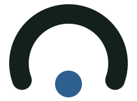

<div align="center">

<picture>
  <source media="(prefers-color-scheme: dark)" srcset="docs/assets/banner-dark.svg">
  
</picture>

<br>

**Il progetto di ricerca che fissa le garanzie per un'AI che parla dei dibattiti delle istituzioni italiane, apre i dati e ne verifica il rispetto.**

<br>


<br>

<!-- famiglia:start (keep identical across repos) -->
<table align="center">
  <tr>
    <td align="center" valign="bottom" width="160">
      <a href="https://www.parliamentrag.it">
        <picture>
          <source media="(prefers-color-scheme: dark)" srcset="docs/assets/famiglia/parliamentrag-dark.svg">
          
        </picture>
        <br><b>ParliamentRAG</b>
      </a>
      <br><sub>parliamentrag.it</sub>
    </td>
    <td align="center" valign="bottom" width="160">
      <a href="https://www.stenografo.it">
        <picture>
          <source media="(prefers-color-scheme: dark)" srcset="docs/assets/famiglia/stenografo-dark.svg">
          
        </picture>
        <br><b>Stenografo</b>
      </a>
      <br><sub>stenografo.it</sub>
    </td>
    <td align="center" valign="bottom" width="160">
      <a href="https://www.fascicoli.it">
        <picture>
          <source media="(prefers-color-scheme: dark)" srcset="docs/assets/famiglia/fascicoli-dark.svg">
          
        </picture>
        <br><b>Fascicoli</b>
      </a>
      <br><sub>fascicoli.it</sub>
    </td>
    <td align="center" valign="bottom" width="160">
      <a href="https://www.scranno.it">
        <picture>
          <source media="(prefers-color-scheme: dark)" srcset="docs/assets/famiglia/scranno-dark.svg">
          
        </picture>
        <br><b>Scranno</b>
      </a>
      <br><sub>scranno.it</sub>
    </td>
  </tr>
</table>
<!-- famiglia:end -->

</div>

<br>

## Cosa fa

ParliamentRAG è un progetto di ricerca dell'Università di Milano-Bicocca. Studia come usare l'intelligenza
artificiale sui lavori parlamentari senza perdere le fonti, e lavora su tre fronti:

- **Metodo.** Fissa i criteri che una risposta sul Parlamento deve rispettare: dare voce a tutti i gruppi,
  scegliere per ognuno chi conosce il tema, citare solo testo detto in Aula con il link al resoconto.
- **Dati.** Costruisce dagli open data ufficiali un knowledge graph del Parlamento (Camera e Senato),
  XIX legislatura, e lo pubblica intero.
- **Verifica.** Prepara un verificatore pubblico che controlla quei criteri su qualunque risposta: il
  piano è in [`docs/piano-verifica.md`](docs/piano-verifica.md).

Sullo stesso grafo lavorano tre sistemi, ognuno con un compito:

| Sistema | Cosa fa |
|---|---|
| [Stenografo](https://www.stenografo.it) | Risponde a domande sui lavori della Camera: sedute, atti, voti |
| [Fascicoli](https://www.fascicoli.it) | Riassume un tema rispettando i criteri fissati da ParliamentRAG |
| [Scranno](https://www.scranno.it) | Ti porta in prima persona nell'Aula di Montecitorio, a vedere il lavoro di ognuno di quelli che ci lavorano ogni giorno |

Questo repository contiene il sito [parliamentrag.it](https://www.parliamentrag.it), la guida al
[server MCP](docs/mcp.md) e il piano della verifica.

Le pagine, in italiano alla radice e in inglese sotto `/en`:

| Pagina | Italiano | Inglese |
|---|---|---|
| Home: il problema, le tre garanzie, i sistemi, i numeri del grafo | `/` | `/en` |
| Metodo: il percorso di una domanda, i sei pesi dell'autorevolezza, la bussola, i limiti | `/metodo` | `/en/method` |
| Verifica: l'anteprima del verificatore delle tre garanzie | `/verifica` | `/en/verification` |
| Dati: il grafo RDF, lo schema, i vocabolari, i download | `/dati` | `/en/data` |
| Ricerca: gli articoli di ISWC 2026 con BibTeX, gli interventi pubblici | `/ricerca` | `/en/research` |
| Sviluppatori: il server MCP, le API su richiesta, i dump | `/sviluppatori` | `/en/developers` |
| Aggiornamenti: le novità e l'iscrizione alla newsletter | `/aggiornamenti` | `/en/updates` |
| Privacy e termini | `/privacy`, `/termini` | `/en/privacy`, `/en/terms` |

Gli indirizzi del sito precedente (`/method`, `/data`, `/pubblicazioni`, `/sistemi`) reindirizzano alle pagine
nuove; le vecchie pagine operative (chat, temi, timeline, parlamentari, gruppi, classifica, bussola, ricerca) e il
questionario della demo `/iswc` reindirizzano a Fascicoli. L'elenco sta in `next.config.ts`.

<br>

## Cosa è aperto

Puoi scaricare il grafo intero, interrogarlo da un assistente AI e leggere il codice del sistema descritto
nei paper. Stenografo, Fascicoli e Scranno non sono in questa tabella.

| | Dove | Licenza |
|---|---|---|
| **Grafo in RDF** | Zenodo, [DOI 10.5281/zenodo.21560331](https://doi.org/10.5281/zenodo.21560331). Turtle, voti individuali in N-Triples a parte | CC BY-SA 4.0 |
| **Grafo in tabelle** | Hugging Face, [emeierkeio/parliamentrag-camera-leg19](https://huggingface.co/datasets/emeierkeio/parliamentrag-camera-leg19), aggiornato con i dati | CC BY-SA 4.0 |
| **Server MCP** | `https://mcp.parliamentrag.it/mcp`: interventi, sedute, votazioni voto per voto, emicicli | accesso libero |
| **Sistema di ricerca** | [Emeierkeio/parliamentrag-iswc](https://github.com/Emeierkeio/parliamentrag-iswc): pipeline dei dati, retrieval, autorevolezza, prompt. Archiviato su Zenodo, [DOI 10.5281/zenodo.23173703](https://doi.org/10.5281/zenodo.23173703) | Apache 2.0 |

I termini propri del progetto e gli URI delle entità usano il namespace persistente
`https://w3id.org/parliamentrag/`.

<br>

## Come è fatto

Il sito usa il design system «Resoconto» della famiglia: HTML, CSS e piccoli script senza framework. Next.js
serve le pagine come documenti statici generati al build (route handler, niente React nel browser), più la route
della newsletter e quella dei numeri del grafo.

```
ParliamentRAG/
├── src/sito/             guscio delle pagine (testata, piede, metadati), indirizzi, contenuti it/en
│   ├── pagine/it, en/    il contenuto di ogni pagina nelle due lingue
│   ├── dinamici.ts       parti scritte dai dati al build: citazioni, seggi, numeri
│   ├── legale.ts         privacy e termini, dal testo in messages/<lingua>.json
│   └── dati-base.json    le 11 citazioni verificate del tema d'esempio
├── src/app/              un route handler per pagina, /sito/dati.js, /api/newsletter
├── public/sito/          famiglia.css, famiglia.js, font, script e stili delle pagine, aula.js
├── src/data/             fotografia notturna del grafo (site-data.json)
├── messages/             testi di privacy e termini (e della newsletter) in it ed en
├── scripts/              snapshot dei dati e schermate di avvio iOS
└── docs/assets/          grafiche di questo README (build_banner.py)
```

L'unica route con dati personali, `/api/newsletter/subscribe`, passa l'indirizzo a Brevo, che gestisce il doppio
consenso; il sito non lo salva.

I numeri del grafo arrivano a ogni pagina da `/sito/dati.js`: le citazioni di `src/sito/dati-base.json` più i
numeri letti da `/api/data/stats` del backend, rigenerati al massimo ogni 10 minuti. Se il backend non risponde
restano quelli di `src/data/site-data.json`, che il job notturno aggiorna con:

```bash
node scripts/snapshot-data.mjs            # oppure: node scripts/snapshot-data.mjs <api_base>
```

La stessa fotografia finisce nell'HTML al build, così le pagine nascono già con i numeri e non si spostano.

<br>

## Avvio in locale

<details>
<summary><b>Requisiti e comandi</b></summary>

<br>

Ti servono Node 20+ e npm.

```bash
npm install
cp .env.example .env.local
npm run dev         # http://localhost:3000
```

Per la build di produzione: `npm run build` e poi `npm run start` (server Next standalone). C'è anche
`npm run lint`.

</details>

<details>
<summary><b>Variabili d'ambiente</b></summary>

<br>

In locale puoi lasciarle vuote. Il modello sta in `.env.example`.

| Variabile | Note |
|---|---|
| `BREVO_API_KEY`, `BREVO_LIST_ID`, `BREVO_DOI_TEMPLATE_ID` | newsletter; senza, il modulo risponde che l'iscrizione non è disponibile |
| `PUBLIC_SITE_URL` | URL pubblico, default `https://www.parliamentrag.it` (canonical, hreflang, sitemap) |
| `PARLIAMENTRAG_API` | backend per i numeri del grafo, default `https://thesis-parliamentrag-production.up.railway.app` |
| `NOINDEX` | `1` aggiunge `X-Robots-Tag: noindex` (anteprime) |
| `HOSTNAME` | `0.0.0.0` in produzione, serve al server standalone |

</details>

<br>

## Deploy

Progetto Railway **ParliamentRAG centro**, con il servizio `sito` collegato a GitHub, branch `main`, in
Europa (`europe-west4`, Paesi Bassi). Il database `Postgres` dello stesso progetto conserva le risposte
raccolte dal questionario prima del 6 ottobre 2026. Ogni push su `main`
ripubblica il sito. I domini `www.parliamentrag.it` e `parliamentrag.it` puntano al servizio `sito`; il
dominio senza `www` reindirizza a quello con `www`.

<br>

## Pubblicazioni

Due articoli accettati a ISWC 2026 (Bari, 25–29 ottobre 2026):

- **Who Speaks Matters: Authority-Aware Multi-View Retrieval-Augmented Generation over Italian
  Parliamentary Proceedings**. In-Use Track, LNCS 17128, cap. 24.
  [DOI 10.1007/978-3-032-42029-9_24](https://doi.org/10.1007/978-3-032-42029-9_24) ·
  [arXiv 2608.13410](https://arxiv.org/abs/2608.13410)
- **ParliamentRAG: An Authority-Aware Multi-View RAG System for Italian Parliamentary Proceedings**.
  Posters & Demos.

Il codice del sistema presentato sta in [Emeierkeio/parliamentrag-iswc](https://github.com/Emeierkeio/parliamentrag-iswc):
il tag `iswc2026-eval` è il codice delle risposte valutate nel paper, il tag `iswc2026-demo` è la versione
della demo, che risponde su
[truthful-amazement-production.up.railway.app](https://truthful-amazement-production.up.railway.app).
Zenodo archivia entrambi i tag: [DOI 10.5281/zenodo.23173703](https://doi.org/10.5281/zenodo.23173703).

> [!NOTE]
> I paper citano `github.com/Emeierkeio/ParliamentRAG`. Fino a ottobre 2026 quel nome apparteneva al
> repository del sistema di ricerca; dal 6 ottobre appartiene al sito. Il codice citato, con il tag
> `iswc2026-eval`, lo trovi in [parliamentrag-iswc](https://github.com/Emeierkeio/parliamentrag-iswc/tree/iswc2026-eval).

<details>
<summary><b>BibTeX</b></summary>

<br>

```bibtex
@inproceedings{tritella2026whospeaksmatters,
  author    = {Tritella, Mirko and Pozzi, Riccardo and Palmonari, Matteo},
  title     = {Who Speaks Matters: Authority-Aware Multi-View Retrieval-Augmented Generation over Italian Parliamentary Proceedings},
  booktitle = {Proceedings of the 25th International Semantic Web Conference (ISWC 2026), In-Use Track},
  series    = {Lecture Notes in Computer Science},
  volume    = {17128},
  publisher = {Springer},
  year      = {2026},
  doi       = {10.1007/978-3-032-42029-9_24}
}
```

</details>

Mirko Tritella, Riccardo Pozzi e Matteo Palmonari conducono il progetto all'Università di Milano-Bicocca.
Lo finanzia il programma Horizon Europe (grant [101189771](https://doi.org/10.3030/101189771), DataPACT).

<br>

<div align="center">
<sub>
Dati: Camera dei Deputati, <a href="https://creativecommons.org/licenses/by-sa/4.0/deed.it">CC BY-SA 4.0</a>; Senato della Repubblica, <a href="https://creativecommons.org/licenses/by/3.0/it/">CC BY 3.0</a>.
<br>
Progetto indipendente: non è affiliato alla Camera dei Deputati né al Senato della Repubblica e non ne rappresenta la posizione.
</sub>
</div>
